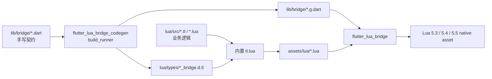

# 项目架构

仓库使用 Dart workspace 管理运行时、注解和生成器三个独立包。应用在运行期只
依赖运行时；注解由运行时再导出；生成器和 `build_runner` 是开发期依赖。运行
时不依赖生成器，生成器依赖运行时（用它来运行 Teal 编译器）。



`flutter_lua_bridge_codegen_annotation` 只包含 `@LuaApi`、`@DartApi`、
`@LuaName` 和 `LuaOptimization`。`flutter_lua_bridge_codegen` 提供三个
Builder：生成 Dart part、生成 Teal 声明、把 Teal 编译成 Lua。
`flutter_lua_bridge` 负责 `LuaRuntime`、值编解码和 Native Assets。

## 目录约定

```text
examples/flutter_lua_bridge_example/
├── build.yaml                   # 把 lua/** 加入构建输入
├── lib/bridge/
│   ├── battle.dart              # 手写契约
│   └── battle.g.dart            # 生成：客户端、注册函数、编解码
├── lua/
│   ├── tlconfig.lua             # 仅供编辑器使用
│   ├── src/cards.tl             # 手写 Teal / Lua
│   └── types/battle_bridge.d.tl # 生成：Teal 声明
└── assets/lua/battle.lua        # 生成：编译产物，作为 Flutter asset
```

`dart run build_runner build` 一条命令完成全部生成。运行时只接收编译后的 Lua
文本；Teal 和生成器都属于开发期工具链，不需要 LuaRocks、Cyan 或系统 Lua。

生成器支持三档安全级别：

- `O1`（默认）：Lua 参数/返回值运行时类型检查，方法体用 `pcall` 捕获，
  返回 `LuaCallResult<T>`；
- `O2`：去掉 Lua 类型检查，只保留 `pcall` 和错误结果；
- `O3`：直接调用，返回 `T`，未捕获错误以 `LuaBridgeException` 抛出。

默认级别在 `build.yaml` 的 `optimization` 选项里配置，
`@LuaApi(optimization: LuaOptimization.o3)` 可以按接口覆盖。

设计细节见 [`docs/codegen-design.md`](docs/codegen-design.md)。

## 验证入口

```sh
./tool/ci_light.sh                                        # 日常门禁
./tool/ci.sh                                              # 发布门禁
python3 packages/flutter_lua_bridge/tool/test_native.py   # C 层，全部内置 Lua
./tool/test_lua_versions.sh                               # 运行时与生成器，全部内置 Lua
```
