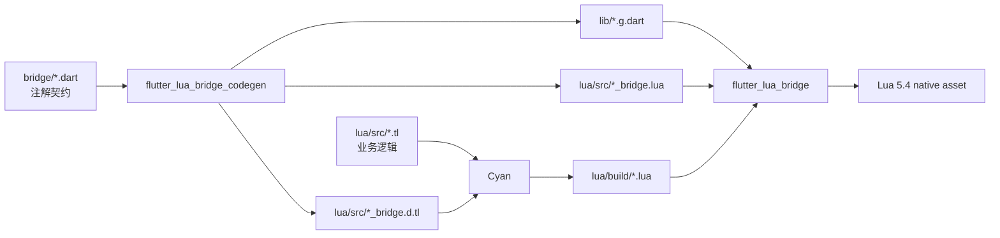

# 项目架构

仓库使用 Dart workspace 管理运行时、注解和生成器三个独立包。依赖方向
只有应用 → 运行时，应用开发工具 → 注解/生成器；运行时不依赖 AST 解析器，
因此发布包不会把代码生成依赖带进 Flutter 应用。



`flutter_lua_bridge_codegen_annotation` 只包含 `@LuaApi`、`@DartApi`、
`@LuaName` 和 `@ConfigureLuaBridge`。`flutter_lua_bridge_codegen` 负责解析
Dart AST、校验契约并同时生成 Dart、Lua 和 Teal 产物。`flutter_lua_bridge`
只负责 Runtime、值编解码、Native Assets 和保留的 raw API。

## Teal/Cyan 目录约定

每个应用的 Lua 项目有一个 `tlconfig.lua`：

```text
examples/flutter_lua_bridge_example/lua/
├── tlconfig.lua
├── src/
│   ├── basic.tl                 # 手写 Teal
│   ├── basic_bridge.lua         # 生成的协议胶水
│   └── basic_bridge.d.tl        # 生成的 Teal 声明
└── build/
    └── basic.lua                # Cyan 编译产物，作为 Flutter asset
```

`cyan build` 会检查 `src/` 中的 Teal 并把结果写入 `build/`。运行时只接收
编译后的 Lua 文本；Teal、Cyan 和生成器都属于开发期工具链。

生成器支持三档安全级别：

- `O1`（默认）：Lua 参数/返回值运行时类型检查，方法体用 `pcall` 捕获，
  返回 `LuaCallResult<T>`；
- `O2`：去掉 Lua 类型检查，只保留 `pcall` 和错误结果；
- `O3`：原样直调，不生成额外包装，未捕获错误直接抛出。

可以使用 `-O1`、`-O2`、`-O3`，也可以在 `ConfigureLuaBridge` 中配置
`optimization: 'O1'`。

## 验证入口

```sh
dart analyze --fatal-infos
dart test
python3 packages/flutter_lua_bridge/tool/test_native.py
cd examples/flutter_lua_bridge_example/lua && cyan build
```
